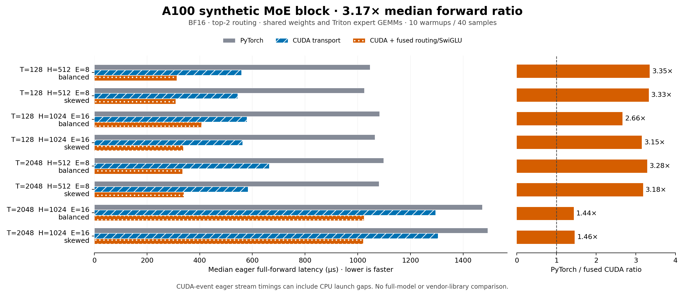
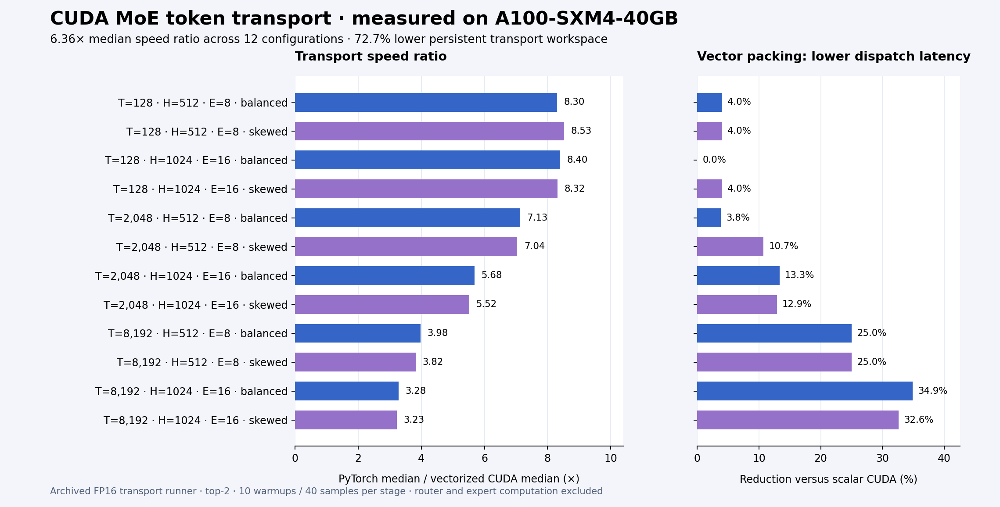

# CUDA MoE Dispatch Engine

A single-GPU inference experiment covering the complete MoE feedforward path:
FP32 router and top-k selection, CUDA token dispatch, grouped expert matmuls,
SwiGLU, and weighted output combination. The C++/CUDA operators also work as
standalone transport primitives.

The repository includes a PyTorch reference, reusable workspaces, edge-case tests,
full-block comparisons, optional CUDA Graph replay, Chrome profiler traces, and
portable HTML demos. Workloads use seeded synthetic tokens and weights.

## Verified A100 full-forward result

**3.17× median eager full-forward speed ratio** (range **1.44–3.35×**) versus
this repository's PyTorch variant across eight synthetic MoE configurations on
**NVIDIA A100-SXM4-40GB**. All three variants share weights and the **Triton grouped
expert GEMM backend**. Each case uses ten warmups and forty CUDA-event samples.
The ratio is the median of eight per-case ratios, not a ratio of pooled samples.

The recorded run passed **81 CPU tests, 39 GPU tests, 36 standalone transport
checks, and all 24 quick-suite full-forward oracle comparisons**. Maximum absolute
error was **0.0078125**, and maximum relative L2 error was **0.0002143**. All 22
measured source hashes match the release. The profiler trace includes GPU kernels.



**Open [the interactive recorded-results demo](demo/index.html)** after downloading
the repository. It works offline with no GPU or server: filter workloads, inspect
isolated stages and median/p95, and download raw JSON. It displays recorded
measurements; GPU execution uses the CLI/API or included Colab notebooks.

Evidence: [raw full-forward samples](benchmarks/a100-block/block_results.json),
[original generated report](benchmarks/a100-block/block_report.html),
[CSV](benchmarks/a100-block/block_report.csv),
[verified summary](benchmarks/a100-block/summary.json),
[run log](benchmarks/a100-block/run.log), and
[profiler trace](benchmarks/a100-block/moe_block_trace.json).
Run `python scripts/verify_release.py` to check both checkpoints and source integrity.

These are **synthetic single-block eager forward** measurements. CUDA-event stream
timings can include CPU launch gaps. No pretrained model, training, multi-GPU,
whole-language-model, or production MoE-library comparison was measured.
Additional runs with unchanged engine sources are now verified:

| Experiment | Coverage | Median ratio: PyTorch / fused CUDA |
|---|---|---|
| CUDA Graph replay | 8 cases; 24 replay checks passed | **1.74×** (range 1.15–2.53×) |
| Larger synthetic eager block | H=4096, I=14336, E=8; 2 cases; 6 oracle comparisons passed | **1.06×** |

The graph-to-graph comparison is distinct from eager timing. The eager rerun
within the graph experiment measured 3.08× median, illustrating variation between
runs. The larger preset measured 1.0595× and 1.0699× in its two cases. The primary
3.17× claim remains scoped to the original eight small/medium eager cases.

See [graph evidence](benchmarks/a100-block/graphs/block_results.json) and
[larger-preset evidence](benchmarks/a100-block/model/block_results.json).

### Preserved transport checkpoint

The earlier, separate FP16 experiment measured **6.36× median dispatch-and-combine
ratio** against the included preallocated PyTorch reference across 12 A100 cases,
**72.7% lower explicit persistent transport workspace**, and up to **34.9% lower
dispatch latency** with vector packing versus scalar CUDA. This excludes router
and expert compute; workspace is not peak GPU memory.



The [transport archive](benchmarks/a100/results.json),
[exact earlier runner](benchmarks/a100/source/runner.py), and
[transport hashes](benchmarks/a100/manifest.json) remain intact.

## Run in a prepared CUDA environment

Use an NVIDIA GPU, a compatible CUDA PyTorch installation, `nvcc`, a C++ compiler,
and Ninja. The recorded full-forward run used Python 3.13.15, PyTorch 2.11.0+cu130, and CUDA 13.0.
A100 or newer is the intended BF16 full-block target. Keep a working PyTorch install.

```bash
python -m pip install -e '.[dev,gpu]'
moe-dispatch check-env
moe-dispatch validate
moe-dispatch block-benchmark --suite smoke --output runs/block-smoke
moe-dispatch block-benchmark --suite quick --output runs/block-quick
moe-dispatch profile-block --output runs/moe_block_trace.json
```

The first CUDA call compiles the extension; subsequent calls use PyTorch's cache.
The default grouped-matmul backend is the device-scheduled Triton adapter when
Triton is installed, otherwise `torch.nn.functional.grouped_mm`. Pass
`--expert-backend torch` or `--expert-backend triton` for an explicit comparison.
The selected backend is recorded and shared across all benchmark variants.

Open `runs/block-quick/block_report.html` for the full-forward demo. Load
`runs/moe_block_trace.json` in a Chrome-trace viewer such as Perfetto. The report
separates full forward from isolated router, dispatch, expert, and combine timings.

Optional runs after the core checks pass:

```bash
moe-dispatch block-benchmark --suite quick --cuda-graphs --output runs/block-graphs
moe-dispatch block-benchmark --suite model --output runs/model-shaped
moe-dispatch benchmark --suite full --output runs/transport-full
python -m pytest -q
```

`model` uses a larger 4096-hidden / 14336-intermediate / 8-expert / top-2 configuration.
It allocates a few GB of synthetic expert weights; run it after the smaller suite.

## Reusable API

```python
import torch
from moe_dispatch import MoEBlock
from moe_dispatch.layer import MoEConfig

block = MoEBlock(MoEConfig(hidden=512, intermediate=1024, experts=8, topk=2),
                 device="cuda", implementation="cuda_fused")
x = torch.randn(128, 512, device="cuda").bfloat16()
with torch.inference_mode():
    y = block(x).clone()  # Clone when retaining output across subsequent calls.
assert y.shape == x.shape
```

For transport-only integration:

```python
from moe_dispatch import dispatch, combine

expert_ids = torch.randint(0, 8, (128, 2), device="cuda", dtype=torch.int32)
probabilities = torch.softmax(torch.randn(128, 2, device="cuda"), dim=-1)
batch = dispatch(x, expert_ids, experts=8)
expert_outputs = batch.packed  # Substitute real expert results in this layout.
y = combine(expert_outputs, batch, probabilities)
```

The convenience API validates ID bounds and can synchronize. Reuse `CudaWorkspace`
with prevalidated inputs in hot loops; those are the methods used in benchmarks.
Packed tensors and outputs are workspace views. Use separate workspaces for
concurrent calls and clone retained outputs before reusing a workspace.

## Implementation and comparisons

| Component | Implementation |
|---|---|
| Router | FP32 projection; fused CUDA bias/top-1/top-2/selected-score softmax alternative |
| Dispatch | Atomic local slots, compact/aligned offsets, scalar or vector row packing |
| Padding | GPU counts and zeroed per-expert padding; fixed capacity retains dynamic offsets on device |
| Experts | Two grouped BF16 matmuls using the same backend across variants |
| Activation | Matched FP32 SwiGLU math; fused CUDA alternative with one final cast |
| Combine | One writer per output element; FP32 accumulation of selected expert outputs |
| Validation | Independent token-major oracle, empty/skewed expert loads, odd widths, and multiple precisions |

Full-block variants:

- `torch`: PyTorch transport, grouped GEMMs, PyTorch SwiGLU.
- `cuda`: CUDA transport, the same grouped GEMMs, PyTorch SwiGLU.
- `cuda_fused`: CUDA transport, the same grouped GEMMs, fused CUDA routing and SwiGLU.

The grouped-GEMM adapter follows the persistent scheduling pattern in NVIDIA's
Triton tutorial, with GPU-resident expert offsets and masks for partial tiles.
It is not a claim of a new production GEMM library. No multi-GPU communication,
backward pass, pretrained-model quality result, or vendor MoE-library speed comparison
is included.

## CPU checks and demo without a GPU

```bash
python -m pytest -q -m 'not gpu'
python scripts/verify_release.py
moe-dispatch summarize --input benchmarks/a100/results.json
moe-dispatch report --input benchmarks/a100/results.json --output demo.html
```

Report/summarize commands use only the standard library. For a report-only install
in an environment without PyTorch, use `python -m pip install -e . --no-deps`.
CI runs CPU numerical/reference tests and recorded-evidence checks; CUDA tests
are explicitly skipped on CPU workers.

## More detail

- [Design and buffer lifetimes](docs/design.md)
- [Benchmark methodology and reproduction](docs/benchmarking.md)
- [Current validation status](docs/validation.md)
- [Resume claim boundaries](docs/resume.md)
- [Full reproduction Colab notebook](notebooks/Colab_Upgrade.ipynb)
- [Optional graph / larger-preset Colab notebook](notebooks/CUDA_MoE_Optional_A100.ipynb)
- [Release notes and publishing](docs/release.md)

## References

- [NVIDIA MoE permutation stages](https://docs.nvidia.com/megatron-core/developer-guide/latest/apidocs/core/core.inference.moe.permute.html)
- [NVIDIA fused MoE pipeline](https://docs.nvidia.com/megatron-core/developer-guide/latest/apidocs/core/core.inference.moe.fused_moe.html)
- [NVIDIA/Triton grouped GEMM tutorial](https://triton-lang.org/main/getting-started/tutorials/08-grouped-gemm.html)
- [PyTorch grouped_mm](https://docs.pytorch.org/docs/2.11/generated/torch.nn.functional.grouped_mm.html)
- [PyTorch CUDA extensions](https://docs.pytorch.org/docs/stable/cpp_extension.html)

MIT license; attribution for the tutorial scheduling pattern is retained in
[THIRD_PARTY_NOTICES.md](THIRD_PARTY_NOTICES.md).
